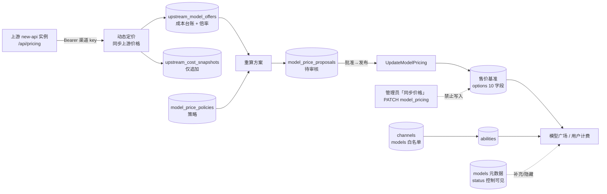

# OpenBridger 定价与模型数据流：标准流程 + 整改计划

- 状态：**已实施（代码 + 文档，2026-11-04）**；D1–D4 已落地，D5 仍需真实 key 对账　日期：2026-11-04
- 实证基线：`main` @ `08cdbc8d2`（本轮全部结论均按此 commit 的代码查证）
- 适用范围：OpenBridger 生产实例「系统设置 → 模型与路由 → 动态定价控制」及「管理员 → 模型」相关链路
- 关联文档：`docs/openbridger/launch-runbook.md`（S20–S24）、`docs/pricing-control-plane.md`、`docs/openbridger/defect-list-pricing-control.md`、`docs/openbridger/launch-execution-plan.md`
- 本文件不含任何密钥、DSN、上游域名或 token；命令中的 `<UPSTREAM_KEY>` 一律由服务器 `/srv/openbridger/.env`（600）注入，不落文档、不落聊天记录

> **实施状态（2026-11-04）**：P0 全部 6 项、P1 的 1/2/3/4/5/6/7/8 项、P2 全部 2 项已落到代码与文档；P1-9（把三个任务串成单一流水线）**有意未做**，理由见 §10。代码在工作区未提交，需重新构建发布镜像后才会在生产生效。

---

## 0. 一页结论

**唯一写入方规则（后面所有流程都服从这三条）**

1. **采购成本**：只由「动态定价控制 → 同步上游价格」（或 `POST /api/pricing-control/offers/import` 人工导入）写入 `upstream_model_offers` / `upstream_cost_snapshots`。
2. **售价**：只由「动态定价控制 → 批准 → 发布」写入模型计费配置（`model.UpdateModelPricing`）。管理员模型模块的「同步价格」**降级为只读预览或停用**。
3. **模型目录与可见性**：只由渠道能力（`abilities`）+ 「同步资料」的元数据决定；动态定价不写模型目录。

**从部署启动到出价的固定链条（不可跳步）**

```
【首次上线，人工】
部署启动 → 加固 root → 建渠道 → 拉模型白名单 → （可选）同步资料
        → 配定价策略 → 同步上游价格（同时带入上游倍率）→ 自动重算
        → 待审核方案 → 批准 → 发布售价 → 与上游账单对账

【日常运行，自动】
每天 1–2 次：上游模型检测 → 价格与倍率采集 → 重算 → 生成/更新待审方案
        → 人工审批 → 发布（唯一写售价的路径）
```

**本轮新查实、且直接影响数据安全的 7 件事**

| # | 事实 | 代码位置 |
|---|---|---|
| N1 | 生产 `compose.release.yml` 把 `PRICING_AUTO_PUBLISH` 写死为 `"true"`，`.env` 改不动；而 `launch-runbook.md` S24 写「可选自动发布（默认关闭）」——**部署配置与手册相反**，售价实际处于无人值守自动改写状态 | `compose.release.yml:33-34` vs `launch-runbook.md:284` |
| N2 | `PRICING_AUTO_PUBLISH_OPERATOR_ID` 写死 `"1"`，服务层要求该 ID 是启用中的 root，否则整轮同步任务判 failed | `compose.release.yml:34`、`service/pricing_control.go:633-649` |
| N3 | 手动「同步上游价格」**不触发**自动发布；定时 `pricing_offer_sync` **会触发**。同名动作两种结果 | `controller/pricing_control.go:45` vs `service/pricing_offer_sync.go:281-295` |
| N4 | 前端每 **15 秒** 并发拉 4 个全量接口（报价不过滤过期、方案 `LIMIT 500`），且 `offers.map()` 全量渲染 | `pricing-control-section.tsx:71-75`、`pricing-control-api.ts:32-44`、`pricing-control-inventory.tsx:78` |
| N5 | `upstream_cost_snapshots` **只追加、无任何清理逻辑**，每轮同步每模型每渠道一条，按 40 模型 / 60 分钟估算约 960 条/天 | `model/pricing_control.go:209`、全库无 delete/prune |
| N6 | 「同步资料」全量应用时 `status` 与 `name_rule` 属于默认全选字段；`models.status != 1` 会让该模型从模型广场消失，**全量同步可能反向隐藏渠道里正在售卖的模型** | `model/model_metadata_sync.go:40,213-215`、`model/pricing.go:371-375` |
| N7 | dddai 实测 50 个模型里 **28 个同时在多个组**，现有逻辑按 `auto_groups` 顺序取第一个匹配项，与 key 实际所属组无关；上游还提供 `model_group_ratio`（模型×组），本地**完全不解析** | `service/pricing_offer_sync.go:208-219`、`setting/ratio_setting/group_ratio.go:88`、§1.1 |

---

## 0.1 已拍板决策（2026-11-04 确认，后续按此执行）

| ID | 决策项 | 结论 | 对计划的影响 |
|---|---|---|---|
| **D1** | 是否启用 `PRICING_AUTO_PUBLISH` | **先关**（人工审批跑通、P0-1 结论落地后再评估） | P0-2 的 compose 默认值取 `false`；P0-4 统一到「只重算、不发布」；阶段 G 流水线止于「生成待审方案」 |
| **D2** | 售价唯一写入方 | **是**，只留动态定价「批准→发布」 | P0-3 加后端守卫；管理员「同步价格」仅保留差异预览 |
| **D3** | 人工导入 vs 自动采集 | **自动采集优先** | P1-4 按 `new-api-pricing` > `manual` 实现，低优先级不得覆盖未过期高优先级 |
| **D4** | 全局策略继承规则 | **全局为基础，指定模型可覆盖全局**（只影响被覆盖的那个模型） | P2-1 按 `scope=global` 默认行 + 模型级覆盖实现，不做全局回写 |

已确认事实：**root 用户 ID = 1**（与 `compose.release.yml:34` 现值一致，A3 可保留但需校验该用户仍为启用状态）；上游 `https://api.dddai.dev`。

---

## 1. 实证基线（含对前几轮结论的更正）

| 项 | 查证结果 | 位置 |
|---|---|---|
| 启动顺序 | `InitResources()` → `model.InitDB()`（AutoMigrate 含定价表）→ `CheckSetup()` → `InitOptionMap()`；主进程 `model.GetPricing()` 预热 → `RegisterScheduledSystemTasks()` → `StartSystemTaskRunner()` | `main.go:59,110,156-157,289-379`、`model/main.go:369` |
| 定时任务真的会跑 | 两个 pricing handler 由各自 `init()` 自注册，runner 每轮快照 registry 遍历 `ScheduledSystemTaskHandler`，仅 **master 节点**执行，`Enabled()` 读 `PRICING_CONTROL_ENABLED` | `service/system_task.go:57-74,123-155,263-275`、`service/pricing_offer_sync.go:244-298`、`service/pricing_control.go:859-882` |
| 同步间隔 / 有效期 | offer sync 默认 60 分钟（最低 15）；recalculate 默认 60 分钟（最低 5）；自动采集的报价 `expires_at = now + 2h` | `pricing_offer_sync.go:248-253,236`、`pricing_control.go:864-868` |
| 上游接口 | **硬编码** `GET {channel.baseURL 的 scheme+host}/api/pricing`，丢弃原 path/query；带 `Authorization: Bearer <渠道 key>`；不读管理员「同步端」选项 | `service/pricing_offer_sync.go:137-154` |
| 倍率取值 | 顶层 `auto_groups` 来自上游 `service.GetUserAutoGroup(当前 key 所属组)`（会排除 `auto` 自身）；代码遍历它取**第一个**同时出现在 `data[].enable_groups` 的组，再取 `group_ratio[该组]`，无匹配则 skip 该模型 | `controller/pricing.go:74`、`service/group.go:49,56-70`、`pricing_offer_sync.go:208-219` |
| 成本口径 | 清单的 Input/Output cost 是 `model_ratio × 2`（及 `× completion_ratio`）或表达式在 P=1/C=1 的值，**未乘倍率**；`upstream_group_ratio` 单独存一列；方案计算时才乘 | `pricing_offer_sync.go:300-338`、`service/pricing_control.go:249+` |
| 清单接口 | 后端 `ListUpstreamModelOffers(publicModel)` **支持按模型精确过滤**，但**不过滤 enabled / expires_at、无分页**；前端未传 `model` 参数 | `model/pricing_control.go:217-225`、`controller/pricing_control.go:54-61`、`pricing-control-api.ts:34` |
| 方案列表 | `ListModelPriceProposals` 硬 `LIMIT 500`，无分页 | `model/pricing_control.go:244-252` |
| 售价写入 | 发布 → `model.UpdateModelPricing`；管理员「同步价格」→ `PATCH /api/option/model_pricing` → **同一个** `model.UpdateModelPricing` | `service/pricing_control.go:416-425`、`controller/model_pricing_config.go:21-29`、`web/src/features/model-pricing/api.ts:95-98` |
| 并发保护 | 售价写入有 `ExpectedVersion` CAS，版本不匹配返回 `ErrModelPricingConflict`；所以**并发不静默覆盖，但顺序执行会覆盖**（重新拉预览后再保存即用新版本盖掉发布结果） | `model/model_pricing_config.go:269-299,323-337` |
| 审批防陈旧 | CONC-001/CONC-002 已修：审批时复核报价有效期与价格版本，返回 `ErrPricingProposalStale` | `service/pricing_control.go:316-330`（缺陷清单 §9） |
| 模型广场主体 | `updatePricing()` 从 `GetAllEnableAbilityWithChannels()`（启用渠道能力）建清单；`models` 表只补描述/图标/标签/厂商/端点；有元数据且 `status != 1` 则跳过；**没有元数据不影响展示** | `model/pricing.go:184-190,361-380` |
| 「同步资料」源 | `https://basellm.github.io/llm-metadata/api/newapi/{models,vendors}.json`（可由 `SYNC_UPSTREAM_BASE` 覆盖），`SyncSource` 仅 `official` | `controller/model_sync.go:23`、`web/src/features/models/constants.ts` |
| 「同步资料」写入 | 事务内按 `record_version` 乐观锁，创建时写入 `MetadataSyncFields` 全部 7 个字段（含 `status`、`name_rule`），最后 `RefreshPricing()` | `model/model_metadata_sync.go:40,154-276` |
| 「拉取模型」 | `FetchUpstreamModels` 只是**返回**上游 `/v1/models` 的模型 ID 列表，保存渠道时才落 `channels.models` 白名单；另有定时 `channel_upstream_model_update` 任务 | `controller/channel.go:232-256`、`controller/channel_upstream_update.go` |
| 「同步价格」写入字段 | `POST /api/ratio_sync/fetch` 只返回差异预览；`PATCH /api/option/model_pricing` 才写 `model_ratio / completion_ratio / cache_ratio / create_cache_ratio / image_ratio / audio_ratio / audio_completion_ratio / model_price / billing_mode / billing_expr` 共 10 项，**不含 group_ratio** | `controller/ratio_sync.go:64-77,211`、`web/src/features/system-settings/models/upstream-ratio-sync.tsx:177` |

### 1.1 上游 `api.dddai.dev` 实测（2026-11-04，匿名只读，不含 key）

`GET https://api.dddai.dev/api/pricing` 匿名返回 **HTTP 200 / 51 KB**，无需鉴权即可读到结构：

| 观测项 | 实测值 |
|---|---|
| 模型数 | **50**，`quota_type` 全部为 `0`（token 计费，无固定单价） |
| 顶层字段 | `auto_groups`、`data`、`group_ratio`、`media_groups`、**`model_group_ratio`**、`pricing_version`、`success`、`supported_endpoint`、`usable_group`、`vendors` |
| `auto_groups` | 11 个，**不含 `auto`**：`codex-plus, default, openai-luna, grok, media, gemini, deepseek, glm, kimi, claude-kiro, claude-max` |
| 顶层 `group_ratio` | `claude-max=1.8  openai-luna=1.1  auto=1  deepseek=1  kimi=1  media=1  glm=0.9  enterprise=0.75  openai-pro=0.36  gemini=0.3  grok=0.3  claude-kiro=0.25  default=0.23  codex-plus=0.15  free=0.001` |
| **`model_group_ratio`** | **「模型 × 组」的二维倍率表**，例 `claude-fable-5`：`auto=0.1471`、`claude-kiro=0.0368`、`claude-max=0.2647`、`codex-plus=0.0221` —— 与顶层同名组的值相差 5～7 倍 |

按现有代码逻辑（`pricing_offer_sync.go:208-219`：遍历 `auto_groups` 取第一个出现在 `data[].enable_groups` 的组，再查顶层 `group_ratio`）对这份响应复算：

- 50 个模型全部能匹配到组（`no_match=0`），不会 skip；
- **28 / 50（56%）的模型 `enable_groups` 含多个组**，取值完全由 `auto_groups` 的列表顺序决定，与这把 key 实际所属组无关：
  - `claude-haiku-4-5`：`enable_groups = claude-kiro/claude-max/sub-claude-max/sub-claude-kiro` → 取 `claude-kiro=0.25`；若实际按 `claude-max=1.8` 结算，**差 7.2 倍**；
  - `gpt-5.6-terra`：`enable_groups` 含 `openai-pro/enterprise/default/codex-plus/openai-ent-13481/sub-openai` → 取 `codex-plus=0.15`；若实际 `default=0.23` 差 1.53 倍，`enterprise=0.75` 差 5 倍。
- **本地代码全库没有 `model_group_ratio` 字段**；`ratio_setting.GetGroupGroupRatio` 只支持 `{userGroup: {usingGroup: ratio}}` 二维（`setting/ratio_setting/group_ratio.go:88`），没有 model 维度。上游这份"模型级倍率覆盖"当前被完全忽略。

判定（严格区分已确定与待定）：

- **已确定**：现有取值逻辑不能保证等于账单倍率 —— 多组匹配时取列表首项，与 key 实际组无关；且模型级倍率覆盖被忽略。这足以支撑"成本口径不可信"的结论。
- **待定**：上游计费时 `model_group_ratio` 与顶层 `group_ratio` 的优先级；这把 key 所属组（匿名响应不按用户组覆盖，必须带真实 key 复测一次）。
- 因此 **P0-1 从"核验"升级为"重做倍率解析 + 账单对账"**，见 §6 P0-1 / P0-1b。

**更正记录（前几轮说法按本次实证修订）**

- 「`PRICING_AUTO_PUBLISH` 是否已开启待确认」→ **已在发布 compose 中写死开启**，见 N1。这不是待确认项，是当前生产默认行为。
- 「PC-COST-001 是待修的 S1 缺陷」→ **代码缺陷已于 2026-09-18 修复**（报价与快照新增必填 `upstream_group_ratio`，采购成本乘倍率），剩余工作只有**生产账单对账**（手册 S23 / 缺陷清单 §9）。计划中按「P0 验收」而非「重新开发」处理。
- 「`models.status` 生效位置待确认」→ **已查实**：`model/pricing.go:373` 用 `meta.Status != 1` 跳过，直接控制模型广场可见性。
- 「清单完全没有 filter」→ **后端已有** `GET /api/pricing-control/offers?model=xxx` 精确过滤，缺的是前端接入、过期过滤与分页。
- 「`auto` 组倍率口径是疑点」→ **机制已定位**（见上表「倍率取值」），但「取到的倍率是否等于账单倍率」仍必须拿真实响应核验，见 §6 P0-1 / 附录 A。不下结论。

---

## 2. 数据所有权矩阵（消除冲突的硬规则）

| 数据 | 存储 | 唯一写入方 | 禁止写入方 | 幂等 / 去重 | 生命周期 |
|---|---|---|---|---|---|
| 渠道配置（base_url、key、models 白名单、model_mapping） | `channels` | 管理员建/改渠道；定时 `channel_upstream_model_update` 只更新模型列表 | 动态定价 | 按 channel_id 更新 | 长期 |
| 可路由模型集合 | `abilities` | 渠道保存 / `FixAbility` / 定时模型更新 | 「同步资料」、动态定价 | 按 (channel, model, group) | 随渠道 |
| 模型元数据与广场可见性 | `models`（description / icon / tags / vendor_id / endpoints / name_rule / **status**） | 「同步资料」+ 管理员模型编辑 | 动态定价 | `record_version` 乐观锁 | 长期 |
| **采购成本台账** | `upstream_model_offers` | 动态定价「同步上游价格」+ 人工导入 | 管理员「同步价格」、任何售价侧流程 | `(channel_id, upstream_model, public_model)` upsert 覆盖 | 2h 过期；需清理过期行 |
| **成本快照** | `upstream_cost_snapshots` | 同上（仅追加） | — | 无 → **需加保留策略** | 需定期清理 |
| **售价基准** | options 中 10 个定价字段 | 动态定价「批准 → 发布」（含 `PRICING_AUTO_PUBLISH` 自动发布） | 管理员「同步价格」、手工批量改价（过渡期需显式解锁） | `ExpectedVersion` CAS + 价格版本 | 长期，带审计 |
| 定价策略 | `model_price_policies` | 动态定价策略表单 / 新增全局默认策略 | — | `(public_model, service_tier)` upsert | 长期 |
| 调价方案 | `model_price_proposals` | 重算任务、审批/发布状态机 | — | 同模型同档 pending 合并 | 需归档 |
| 用户分组倍率（营收侧） | options `group_ratio` | 管理员（仅当要给用户分组打折/加价） | 动态定价 | — | 长期 |
| 同步任务结果 | `system_tasks.result` | 任务 runner | 前端 | 按 task_id | 需清理 |

**由此推导出的三条禁令**

- 启用动态定价后，**禁止**再运行管理员「同步价格」的保存动作（`PATCH /api/option/model_pricing`）；只保留差异预览用于人工核对。
- **禁止**用人工导入报价去「修」售价；人工导入只写成本台账，有效期默认 24h，且与自动采集的报价会互相覆盖，须有来源优先级（§0.1-D3）。
- **禁止**把上游 `group_ratio` 同步进本地用户分组 `group_ratio`：前者是采购成本乘数，后者是售价调整，写入同一处会造成 PC-COST-001 那类口径污染。

---

## 3. 端到端标准操作流程（SOP）

> 与 `launch-runbook.md` 的关系：段 1–4（S01–S19）保持不变；本 SOP 替换并细化 **段 5（S20–S24）**，作为唯一执行口径。每步「通过标准」是进入下一步的闸门。

### 阶段 A：部署启动与运行开关

| 步 | 操作 | 通过标准 / 禁止动作 |
|---|---|---|
| A1 | 按 S13 在 `/srv/openbridger/.env` 显式写入 8 个开关（推荐值见本节末表）；先按 §6 P0-2 把 compose 改为可覆盖，再启动 | `.env` 权限 600；`docker compose config` 打印出的值与 `.env` 一致。**禁止**在 compose 里留字面量 `true` |
| A2 | 启动后核对：`/api/status` 200；日志无 DB/panic；`NODE_TYPE=master`（否则定时任务不跑） | 只有 master 跑 `StartSystemTaskRunner()`（`service/system_task.go:125`） |
| A3 | 校验 `PRICING_AUTO_PUBLISH_OPERATOR_ID=1` 对应的用户仍是**启用中的 root**（S15 创建的账号） | 服务层校验不通过会让整轮同步 failed（`pricing_control.go:633-649`）。不要因为「ID 是 1」就跳过校验 |
| A4 | 在系统任务页确认 `pricing_offer_sync` 与 `pricing_recalculate` 两类任务确实产生 succeeded 记录 | 只有注册 + Enabled + 到期才会调度（`system_task.go:263-291`） |
| A5 | 复核自动发布状态（§0.1-D1 已定 **先关**）并留痕 | 手册 S24 与 compose 现值矛盾，必须以 A1 的显式值为准 |

**A1 推荐值（按「每天同步两次 + 人工审批」）**

| 变量 | 值 | 说明 |
|---|---|---|
| `PRICING_CONTROL_ENABLED` | `true` | 总开关；false 时两个 pricing 任务都不调度 |
| `PRICING_AUTO_PUBLISH` | **`false`** | D1 已定：先关 |
| `PRICING_AUTO_PUBLISH_OPERATOR_ID` | `1` | 已确认真实 root ID=1；A3 仍需校验该用户 `status=1` |
| `PRICING_OFFER_SYNC_INTERVAL_MINUTES` | `720` | 12 小时一次 = 每天两次；最低 15，上限无 |
| `PRICING_OFFER_TTL_MINUTES` | `840` | **需新增**（P0-6）。14h > 12h，留 2h 同步失败缓冲；现为硬编码 2h |
| `PRICING_RECALCULATE_INTERVAL_MINUTES` | `720` | 与同步同频，避免每小时空转；最低 5 |
| `CHANNEL_UPSTREAM_MODEL_UPDATE_TASK_ENABLED` | `true` | 上游模型检测任务总开关（`controller/system_task_handlers.go:77-79`） |
| `CHANNEL_UPSTREAM_MODEL_UPDATE_TASK_INTERVAL_MINUTES` | `720` | 每天两次；默认 30，可配（`channel_upstream_update.go:34`） |

### 阶段 B：上游渠道与模型

| 步 | 操作 | 写入对象 | 通过标准 |
|---|---|---|---|
| B1 | 新建渠道：Base URL **统一填 `https://api.dddai.dev`（不带 `/v1`、不带尾斜杠）**，Claude 类型与 OpenAI 兼容类型都如此；填启用 key、分组 | `channels` | 渠道测试连通 200；Claude 走 `/v1/messages`、OpenAI 走 `/v1/chat/completions` 各自实测通过 |
| B2 | 「获取模型列表」→ 勾选需要的模型 → 保存渠道 | `channels.models` 白名单 → 生成 `abilities` | 白名单非空；模型广场出现这些模型；逐个实测非流式/流式（S21） |
| B3 | 如需名称映射，配置 `model_mapping`（公开名 ↔ 上游名） | `channels.model_mapping` | 上游名与公开名的对应关系在清单里可核对 |
| B4 | 验证定价端点可达：用**同一把渠道 key** 请求 `GET https://<上游域名>/api/pricing`（注意：动态定价会把 base URL 的 path 换成 `/api/pricing`，只用 scheme+host） | 只读 | 返回 `success:true`，且 `data[]`、`group_ratio`、`auto_groups` 三项非空。**禁止**在此步修改任何本地价格 |

**B1 的 base URL 必须是 host 层，不能带 `/v1`**（本轮实测，纠正手册 S20）：

- Claude：`relay/channel/claude/adaptor.go:69` 是 `base + "/v1/messages"`；base 填 `/v1` → `/v1/v1/messages` → 404。
- OpenAI：`relay/channel/openai/adaptor.go:180` 是 `base + RequestURLPath`（客户端路径即 `/v1/chat/completions`）；同理重复。
- 定价同步不受影响：`service/pricing_offer_sync.go:142` 会把 path 整个替换成 `/api/pricing`，只用 scheme+host，所以 `https://api.dddai.dev` 与 `https://api.dddai.dev/v1` 采到的是同一份数据。
- 手册 S20 原文「Base 填 `https://<上游域名>/v1`」与当前代码不符，需随 P3-1 一并更正。

> B4 是 D 阶段的硬前置。dddai 的 `https://api.dddai.dev/api/pricing` 已匿名实测 **200 / 51KB / 50 模型**（§1.1）；带 key 复测的目的是看 `group_ratio` 是否被 key 所属组覆盖，这一步决定 P0-1 的最终结论。上游若把定价放在非 `/api/pricing` 路径，当前实现无法采集（§6 P1-5）。

### 阶段 C：同步资料（可选，且必须受控）

| 步 | 操作 | 写入对象 | 通过标准 |
|---|---|---|---|
| C1 | 「同步资料」→ 预览差异 → **只勾选 `description / icon / tags / vendor / endpoints`** | `models` 元数据 | 预览里列出的变更条数 = 实际条数 |
| C2 | **取消勾选 `status` 与 `name_rule`**（新建记录时这两项默认全选，见 N6）；确需批量上架/下架时单独走管理员模型编辑 | `models.status` 保持本地值 | 同步前后模型广场可见模型集合不变 |
| C3 | 应用后 `RefreshPricing()` 自动刷新缓存 | 内存定价缓存 | 广场图标/描述更新，模型数不变 |

**C 阶段的两个确定结论**（回答上轮问题）：
1. 全量同步**不会**把上游目录里几百个模型灌进广场：广场清单主体来自 `abilities`（B2），`models` 表只提供补充元数据（`model/pricing.go:361-380`）。
2. 但它**可能隐藏**已在售模型：只要同步进来的记录 `status != 1`，`model/pricing.go:373` 就跳过该模型；`name_rule` 为前缀/后缀/包含时，一条记录还可能匹配多个在售模型。所以 C2 的取消勾选是必须的。

### 阶段 D：上游价格与倍率（核心）

| 步 | 操作 | 写入对象 | 通过标准 |
|---|---|---|---|
| D1 | **先配定价策略**（至少 1 条启用策略，含 `primary_channel_id`）。没有策略时点同步会直接报 `no pricing channels configured` | `model_price_policies` | 策略列表非空、`enabled=1` |
| D2 | 「同步上游价格」= `POST /api/pricing-control/offers/sync` | `upstream_model_offers`（upsert）+ `upstream_cost_snapshots`（追加） | 同步摘要：`imported > 0`、warnings 可解释、无渠道级 error |
| D3 | 同一次请求从上游 `/api/pricing` 的 `group_ratio` 采集 `upstream_group_ratio` 一并入库。**没有独立的「拉取倍率」按钮** | 同上 | 清单「Group ratios」列每行都有正数倍率 |
| D4 | controller 自动 `RecalculatePricingProposals` → 生成/更新 pending 方案 | `model_price_proposals` | 「待审核方案」数字变化；「需要处理」为空 |

**D 阶段链条**：`渠道 → 策略 → 有效报价（含倍率）→ 重算 → 待审核 → 批准 → 发布`。
**不是**「先点同步上游模型」——`FetchUpstreamModels`（B2）只影响白名单，不产生成本数据。

**倍率到底怎么用**（三种倍率不要混）：

| 名称 | 含义 | 谁在用 | 需要手工维护吗 |
|---|---|---|---|
| `model_ratio` / `completion_ratio` | 每模型的**定价基准**，换算成 USD/百万 token 单价；上游模型广场里每个模型显示的倍率是这一类 | `/api/pricing` 采集 → `normalizedUpstreamTokenCosts` → 报价的 input/output cost | 否，自动采集 |
| 上游 `group_ratio` → `upstream_group_ratio` | 上游账号/自动分组的**真实结算乘数**，是采购成本的一部分（实测 deepseek 6.8 / gemini 0.3 / default 0.2，极差约 45 倍） | 方案计算时乘：`实际采购成本 = 基准单价 × upstream_group_ratio` | **否**，随 `/api/pricing` 采集；不填或 ≤0 会进风险列表 |
| 本地 `group_ratio` | 卖给用户时按**用户分组**打折/加价，营收侧 | 计费时作用于售价 | 仅当要做用户分组定价时才配 |

清单里 Input/Output cost 显示的是**未乘倍率的基准单价**，所以和你上游广场看到的价格对不上；这不是数据错，是展示缺一列「实际采购成本」（§6 P1-1）。

### 阶段 E：策略、审核与发布

| 步 | 操作 | 写入对象 | 通过标准 |
|---|---|---|---|
| E1 | 设置目标毛利 / 最低毛利 / 运营成本 / 主备切换概率 / 自动发布带宽 | `model_price_policies` | 全局策略常驻、每模型可折叠覆盖（§6 P2-1） |
| E2 | 「立即重新计算」（必要时）→ 生成 pending 方案 | `model_price_proposals` | 方案里含当前成本、综合成本、建议售价、现行售价、预计毛利 |
| E3 | 人工审核 → 批准 → 发布 | **售价**（`model.UpdateModelPricing`） | 前台售价与方案一致；价格版本 +1；审计记录存在 |
| E4 | 与上游账单对账（S23）：同一把 key 调用前后取 `/v1/dashboard/billing/usage`，`quota = Δtotal_usage × 5000` | 只读 | 偏差可解释；异常值记录后重测，不口头关闭 |

**E3 之后禁止再跑管理员「同步价格」的保存动作**——它写的是同一份售价，会用新版本盖掉发布结果（§1「并发保护」）。

### 阶段 F：日常运行与巡检

| 步 | 周期 | 检查 |
|---|---|---|
| F1 | 每轮同步后 | `system_tasks.result`：imported / skipped / warnings / error / auto_publish.published\|skipped；任务 failed 时导入统计仍在 result 里 |
| F2 | 每日 | 「需要处理」为空；报价未过期（有效期 2h，间隔 60min，漏 2 轮即整页飘红）；快照表增长在保留策略内 |
| F3 | 每次上游调价后 | 重跑 D2 → E2 → E3；核对 `upstream_group_ratio` 是否漂移（手册 S22 实测几天内 6.8→1、6→0.9），禁止手工填死 |

### 阶段 G：每日自动流水线（每天 1–2 次，产物是待审方案）

**目标**：每天自动完成「上游模型检测 → 价格与倍率采集 → 重算建议售价」，产出待审方案；因 D1 已定「先关自动发布」，流水线**止于 pending**，不写售价。

| 环节 | 现有机制 | 每天两次的配置 | 需改代码 |
|---|---|---|---|
| 1 上游模型检测 | `model_update` 系统任务（`CHANNEL_UPSTREAM_MODEL_UPDATE_TASK_ENABLED` / `_INTERVAL_MINUTES`） | `=720` | 否，环境变量即可 |
| 2 价格 + 倍率采集 | `pricing_offer_sync`（`PRICING_OFFER_SYNC_INTERVAL_MINUTES`） | `=720` | 否 |
| 3 重算方案 | offer sync 成功后自动 `recalculatePricingProposals`；另有独立 `pricing_recalculate` | `=720` | 否 |
| 4 报价有效期 | **硬编码 2h**（`pricing_offer_sync.go:236`） | 需 `PRICING_OFFER_TTL_MINUTES=840` | **是（P0-6）** |
| 5 两个任务的先后顺序 | 各自独立调度，顺序不保证 | — | 可选（P1-9） |
| 6 每轮结果留痕 | `system_tasks.result`（含 imported/skipped/warnings/error） | — | 是（P1-3 页面展示） |

**必须同时改 TTL，否则流水线不可用**：12h 间隔配 2h TTL，等于每天有 20 小时报价处于过期状态 —— 加了 P1-1 的过期过滤后清单会空；`PricingRisks()` 会给每条启用策略报 `*_offer_missing_or_expired`；`buildPriceProposal` 直接 `continue`，一条方案都生不出来。所以 **P0-6 是每日流水线的硬前置**，不能只改间隔。

**时序（间隔按上一轮完成时间顺延，不固定钟点）**

```
T+0      model_update：检测上游 /v1/models；开 auto-sync 的渠道按配置采纳，未开启的只暂存待审
T+0      pricing_offer_sync：采集 50 个模型的价格 + 分组倍率，事务写入 offers 与快照
T+0      recalculate：生成/更新 pending 方案（同模型同档合并）
T+0      result 落库：imported / skipped / warnings / channels[].error / created_proposals
人工     上班后看「待审核方案」→ 逐条批准 → 发布（D2：唯一写售价的路径）
```

**失败与降级**

- 单渠道失败：其余渠道照常导入；失败渠道写入 `channels[].error`，相关策略进风险列表，不影响已成功渠道的方案。
- 整轮失败：报价不写入（P1-4 的事务保证），旧报价仍在 840min TTL 内；下一轮 12h 后重试。
- 连续两轮失败：报价过期 → 风险列表变红 → 必须人工介入；这也是把 TTL 设成 14h 而不是 24h 的原因（要留出可见的告警窗口）。
- 新模型：检测到但没报价时不会生成方案；是否自动加白名单取决于渠道的 auto-sync 开关，默认不自动上架。

**与自动发布的关系**：`PRICING_AUTO_PUBLISH_VERIFY_SAMPLES` 默认 3，要求最近 3 次快照成本一致。12h 一轮意味着要 36h 才凑齐 3 个样本，上游一调价就会被 `cost_unverified` 拦住。当前 D1 已关自动发布，不受影响；将来若开启，需把 samples 调为 1～2 或改用「按采集批次去重」的校验口径。

### 数据流图



---

## 4. 冲突与冗余清单

| ID | 现象 | 后果 | 对应整改 |
|---|---|---|---|
| C-01 | compose 写死 `PRICING_AUTO_PUBLISH=true`、`OPERATOR_ID=1`，与手册「默认关闭」矛盾，`.env` 无法覆盖 | 售价无人值守被改写；operator 无效时任务 failed | P0-2 |
| C-02 | 管理员「同步价格」与动态定价「发布」都写 `model.UpdateModelPricing` | 顺序执行覆盖发布结果；并发 CAS 冲突失败 | P0-3 |
| C-03 | 手动同步不触发自动发布、定时同步会触发 | 同一按钮两种结果，运营无法预期 | P0-4 / P1-6 |
| C-04 | 动态定价 sync 硬编码 `/api/pricing`，不读「同步端」选的 endpoint | 管理员选 `custom` 时两边口径不一致 | P1-5 |
| C-05 | 人工导入报价（24h）与自动采集报价（2h）共用同一张表、同一去重键，无来源优先级 | 互相覆盖，成本基线来源不清 | P1-4 / D3 |
| C-06 | 「同步资料」全量应用默认写入 `status` / `name_rule` | 可能隐藏在售模型（N6） | P0-5 |
| R-01 | `upstream_cost_snapshots` 只追加、无保留策略 | 约 960 条/天（40 模型估算），无限增长 | P1-7 |
| R-02 | `ListUpstreamModelOffers` 不过滤过期/禁用，前端全量渲染 + 15s 全量轮询 4 接口 | 过期数据伪装成有效成本；模型数增长后页面卡死（你第一轮质疑的点，成立） | P1-1 / P1-2 |
| R-03 | `ListModelPriceProposals` 硬 `LIMIT 500`、无分页 | 方案被静默截断 | P1-2 |
| R-04 | `PricingOfferSyncSummary` 只存在组件 state，刷新即丢 | 失败/跳过原因无留痕，无法追责 | P1-3 |
| R-05 | 四个统计卡片无导航；「需要处理」只有英文码、无详情/跳转/消除路径 | 长页面里找不到对应数据，告警无法闭环 | P2-2 / P1-8 |
| R-06 | 清单只有「N pricing policies configured.」，无策略列表、无编辑入口 | 改哪个模型全靠手打名字 | P2-1 |
| R-07 | 策略表单是单模型必填，后端 `model_price_policies` 无全局层 | 「全局常驻 + 每模型折叠」无法用 UI 微调实现 | P2-1 |
| R-08 | 倍率口径核验缺真实响应（§1「倍率取值」） | 若取到的不是账单实际分组倍率，毛利双向失真且报表看不出来 | P0-1 |

---

## 5. 需求与缺陷的状态对齐（避免重复开发）

- `defect-list-pricing-control.md` 的 5 项缺陷（PC-COST-001 / CONC-001 / CONC-002 / EDGE-001 / EDGE-013）**代码缺陷已于 2026-09-18 修复**，并有服务层自动化用例。计划中**不再重开**这些事项。
- PC-COST-001 剩余动作是**生产账单对账**（§3 E4 / 手册 S23），与 P0-1 的倍率口径核验合并执行。
- 手册 S22 提到的事项 `rhU308`（同步 warnings 运营可见）、`r6UjdF`（倍率漂移）与本计划 P1-3、P1-5 直接相关，登记事项时关联，不要新建重复项。

---

## 6. 整改事项（逐文件、可验收）

按依赖排序。**「需决策」列为空的项可在拍板前开工**。

### P0 — 上线阻塞 / 数据准确性

| ID | 事项 | 改动点 | 验收标准 | 需决策 |
|---|---|---|---|---|
| **P0-1** | 重做倍率解析（已有实测证据，见 §1.1） | `service/pricing_offer_sync.go:208-219` 三处：① 不再「遍历 `auto_groups` 取第一个匹配项」，改为按 **渠道 key 实际所属组**取值；② 解析顶层 `model_group_ratio[model][group]`，存在时优先于 `group_ratio[group]`；③ 无匹配或倍率 ≤0 时 skip，warning 里写明模型、可用组、候选倍率 | 50 个模型的取值与上游账单一致，至少覆盖：`claude-haiku-4-5`（4 组可选）、`gpt-5.6-terra`（6 组可选）、`gemini-3.1-pro`（单组）；误差可解释 | **D5**（key 所属组） |
| **P0-1b** | 倍率兜底策略（若无法确定实际结算组） | 增加 `PRICING_GROUP_RATIO_POLICY`：`key_group`（默认，按 key 所属组）/ `max`（取该模型所有可选组中最大倍率，保守防亏）/ `min`（激进）。配置在渠道或全局 | 选 `max` 时，`claude-haiku-4-5` 取 1.8 而非 0.25；切换策略后重新同步，方案里的采购成本随之变化且可追溯 | D5 |
| **P0-2** | 运行开关可覆盖 + 手册对齐 | `compose.release.yml:32-35`：把 `PRICING_CONTROL_ENABLED` / `PRICING_AUTO_PUBLISH` / `PRICING_AUTO_PUBLISH_OPERATOR_ID` / `OPENBRIDGER_ONLINE_PAYMENT_ENABLED` 改为 `${VAR:-默认值}`，默认值与手册一致；`docs/openbridger/launch-runbook.md` S17/S24 同步改口径；`.env` 显式赋值 | `docker compose config` 显示 `.env` 值生效；切 false 后 `system_tasks.result.auto_publish` 不出现；手册不再有「默认关闭」与 compose 相反的表述 | D1、D2 |
| **P0-3** | 售价唯一写入方落地 | `web/src/features/system-settings/models/upstream-ratio-sync.tsx:177` 的 `saveModelPricing()` 调用改为：启用动态定价时禁用「应用/保存」按钮，仅保留差异预览；后端 `controller/model_pricing_config.go:21` 增加开关守卫（读 `PRICING_CONTROL_ENABLED`），拒绝来自 `PATCH /api/option/model_pricing` 的批量写；保留单模型人工改价的显式解锁路径 | 启用动态定价后调用该 PATCH 返回明确错误；动态定价「发布」仍可写；发布后跑一次管理员同步价格，售价不变 | D2 |
| **P0-4** | 手动/定时同步行为统一 | `controller/pricing_control.go:30-52` 与 `service/pricing_offer_sync.go:281-295`：抽公共 `completePricingOfferSync(ctx, result)`，手动与定时都走它；或在 UI 明确标注「手动同步不自动发布」并写进手册 | 同一 payload 下两条路径的 `created_proposals` 与 `auto_publish` 结果一致；单测覆盖两种入口 | D1 |
| **P0-5** | 同步资料默认不碰可见性 | `model/model_metadata_sync.go:40,213-215`：`update.Create` 时默认字段集排除 `status` / `name_rule`（改为显式勾选才写）；新建记录 `status` 默认 1；`web` 同步向导把这两项标为「影响模型广场可见性」并默认不勾 | 全量同步前后，模型广场可见模型集合完全一致；单元测试覆盖 `name_rule` 为前缀时不再批量隐藏 | 否 |
| **P0-6** | 报价有效期可配置（每日两次同步的硬前置） | `service/pricing_offer_sync.go:236`：`now + 2*60*60` 改为 `now + GetEnvOrDefault("PRICING_OFFER_TTL_MINUTES", 120)*60`；启动/同步时校验「TTL < 同步间隔」则记 warning，TTL < 15 分钟直接拒绝 | 设 `interval=720 / ttl=840`：两轮同步之间清单不过期、风险列表不误报、方案能生成；设回 `ttl=120` 行为与当前一致 | 否 |

### P1 — 数据一致性与容量

| ID | 事项 | 改动点 | 验收标准 |
|---|---|---|---|
| **P1-1** | 清单口径与有效性 | `model/pricing_control.go:217-225` 增加 `enabled=1 AND expires_at>now` 过滤 + `limit/offset`；`pricing-control-inventory.tsx` 增加「实际采购成本 = cost × upstream_group_ratio」列、过期行灰显标记、来源标识 | 过期报价不再出现在默认视图；页面上能直接读出与上游账单同口径的采购成本 |
| **P1-2** | 前端分页 / filter / 降频 | `pricing-control-api.ts:32-44` 拆分 4 个 query，offers 与 proposals 传分页+过滤参数；`pricing-control-section.tsx:71-75` 把 `refetchInterval: 15000` 改为按需 + 变更后失效（或 ≥60s）；`pricing-control-inventory.tsx:78` 接入分页/`model` 搜索/来源筛选；`pricing-proposal-review.tsx` 接入分页 | 1000+ 报价行下首屏 < 2s、输入搜索无明显卡顿；后端提供总数 |
| **P1-3** | 同步结果持久化 | 新增 `pricing_sync_runs` 写入（设计文档 §数据库边界已定义该表）或复用 `system_tasks.result`；`pricing-control-section.tsx:66-67,215` 的 `lastSync` 改为从服务端读最近一次同步结果 | 刷新页面后仍能看到上次同步的 imported/skipped/warnings/error 与时间戳 |
| **P1-4** | 报价来源优先级 | `service/pricing_control.go` 的 `ValidateAndImportPricingOffers` 与 `service/pricing_offer_sync.go` 统一 `source_type` 优先级（`new-api-pricing` > `manual`），低优先级不得覆盖高优先级且未过期的行；统一有效期或显式标注 | 自动采集后人工导入同键不改成本；人工导入 24h 后自动采集可覆盖；有单测 |
| **P1-5** | endpoint 口径统一 | `service/pricing_offer_sync.go:137-144` 改为读取渠道/同步端配置里的定价 endpoint（默认仍 `/api/pricing`），并在页面上显示当前实际采集 URL | 管理员选 `custom` 后动态定价按该地址采集；两边显示一致 |
| **P1-6** | 手动同步提示 | `pricing-control-section.tsx:192-215` 增加「本次是否触发自动发布」状态展示（读 `system_tasks.result.auto_publish`） | 手动同步后能看到本轮发布/跳过数 |
| **P1-7** | 快照保留策略 | 新增定时清理：`upstream_cost_snapshots` 保留最近 N 天（默认 30），且只保留**成本发生变化**的快照（同键同值不追加）；`upstream_model_offers` 清理过期 > 7 天行 | 连续同步 24h，快照增长符合预期；清理任务有 succeeded 记录；`PRICING_AUTO_PUBLISH_VERIFY_SAMPLES`（默认 3）仍能取到足够样本 |
| **P1-8** | 「需要处理」可闭环 | `service.PricingRisks()` 返回增加 `channel_id` / `last_collected_at` / `expires_at` / `suggested_action`；`pricing-control-inventory.tsx:50-62` 中文化 4 个风险码，每条给「重新同步」「查看该模型报价」「禁用策略」入口 | 4 种码各有明确动作，点击后能定位到对应数据；告警可消除 |
| **P1-9** | 每日流水线顺序保证（可选） | 新增 `pricing_daily_pipeline` 任务：串行执行「模型检测 → 报价同步 → 重算」，结果合并写 `system_tasks.result`；同时把 `model_update` 与 `pricing_offer_sync` 的独立调度关闭，避免重复跑 | 一轮任务里三个环节按序完成，有单一 task_id 可追溯；连续 3 天无重复执行；失败时能定位到具体环节 |

### P2 — 交互与策略模型

| ID | 事项 | 改动点 | 验收标准 |
|---|---|---|---|
| **P2-1** | 全局策略 + 每模型折叠 + 策略列表 | 后端 `model_price_policies` 增加 `scope='global'` 默认行与 `inherit` 规则；`service/pricing_control.go` 合并全局与模型策略（模型覆盖全局）；前端 `pricing-control-policy-form.tsx` 拆成「全局区常驻展开」+「模型策略列表默认折叠」，列表支持搜索/编辑 | 改一次全局毛利，全部未覆盖模型生效；单模型覆盖后不受全局影响；已有策略可见可改 |
| **P2-2** | 四卡片锚点导航 | `pricing-control-section.tsx:163-178` 的 `summary.map()` 增加 `onClick` 滚到对应区块并高亮：上游报价→清单、策略→策略区、待审核→方案表、风险→「需要处理」 | 四个卡片均可点击，跳转后目标区块高亮且不遮挡 |

### P3 — 文档与回归

| ID | 事项 |
|---|---|
| **P3-1** | 把 §3 SOP 合入 `launch-runbook.md` 段 5（替换 S20–S24 的模糊表述），并更新 `pricing-control-plane.md` §当前实现状态 |
| **P3-2** | 按 §8 补齐自动化回归；三库（SQLite / MySQL 8 / PostgreSQL 17）矩阵各跑一次 |
| **P3-3** | 在 `production-acceptance.md` 填 BILL-001/003/004 执行结果，PC-COST-001 以生产账单对账证据关闭 |

---

## 7. 决策状态

| ID | 决策 | 状态 | 结论 |
|---|---|---|---|
| **D1** | 是否启用 `PRICING_AUTO_PUBLISH` | **已定（2026-11-04）** | **先关**。人工审批跑通一轮、P0-1 落地后再评估 |
| **D2** | 售价唯一写入方 | **已定** | **是**，只留「批准→发布」；管理员「同步价格」只读预览 |
| **D3** | 人工导入 vs 自动采集 | **已定** | **自动采集优先**，人工仅作回退 |
| **D4** | 全局策略继承 | **已定** | **全局为基础，指定模型可覆盖**（只影响该模型，不回写其它模型） |
| **D5** | 上游 key 所属组 / 倍率取值策略 | **待确认** | 见下 |

**D5 是 P0-1 的唯一阻塞项**：ddai 的 50 个模型里有 28 个同时在多个组（§1.1），同一把 key 只会按其中一个组结算，但静态 `/api/pricing` 响应无法告诉你运行时选了哪个组。三种处理：

1. **key 在具体组**（如 `gemini`、`claude-max`）：直接取该组倍率，`model_group_ratio[model][该组]` 优先于 `group_ratio[该组]` —— 最准。
2. **key 在 `auto` 组**（自动分组）：运行时会按可用性/倍率选组，静态无法确定；只能取「该模型所有可选组的最大倍率」保守估算，或按实际用量日志加权（需后续开发）。
3. **不确定**：先用 `PRICING_GROUP_RATIO_POLICY=max` 上线，宁可高估成本、保证不亏；拿到账单后再校准。

已确认事实：**root 用户 ID = 1**；上游 **`https://api.dddai.dev`**，渠道 base 填 host 层（§3 B1），Claude 与 OpenAI 兼容渠道同域。

---

## 8. 回归测试矩阵

| 用例 | 步骤 | 期望 |
|---|---|---|
| T-01 空策略同步 | 不配任何策略点「同步上游价格」 | 返回 `no pricing channels configured`，不写任何表 |
| T-02 无有效倍率 | 上游 `group_ratio` 全为 0 / `auto_groups` 为空 | 逐条 skip 并出现在 warnings，不按 1 猜测成本；风险列表出现 `*_offer_cost_invalid` |
| T-03 过期报价 | 把报价 `expires_at` 改为过去 | 清单默认视图不显示；方案审批返回 `ErrPricingProposalStale`；风险列表出现 `*_offer_missing_or_expired` |
| T-04 发布后跑管理员同步价格 | 发布售价 → 打开管理员同步价格并尝试应用 | 被拒绝或只读；售价与发布结果一致 |
| T-05 并发改价 | 发布与管理员保存同时发起 | 一方返回 `ErrModelPricingConflict`，无静默覆盖 |
| T-06 全量同步资料 | 对已有在售模型执行全量同步资料 | 广场可见模型集合不变；`status` / `name_rule` 未被改写 |
| T-07 手动 vs 定时同步 | 两种入口各跑一轮，比较 `auto_publish` | 结果一致（按 D1 选定口径） |
| T-08 快照增长 | 连续 24 轮同步成本不变 | 快照不无限增长；`VERIFY_SAMPLES=3` 仍可取样 |
| T-09 容量 | 造 1000 条报价、600 条方案 | 首屏 < 2s；搜索响应 < 300ms；方案可翻页看到第 501 条 |
| T-10 倍率漂移 | 上游 `group_ratio` 从 6.8 改 1 后重同步 | 清单「实际采购成本」与方案同步变化，不需要手工改任何倍率 |
| T-11 全局策略 | 改全局毛利、单模型设覆盖值 | 未覆盖模型跟随全局；覆盖模型不变（按 D4） |
| T-12 自动发布关闭 | `PRICING_AUTO_PUBLISH=false` 跑定时同步 | 生成 pending 方案，售价不变，`system_tasks.result.auto_publish` 不出现 |
| T-13 每日两次 + TTL | `interval=720 / ttl=840`，把时间推进 13h（或改库模拟） | 报价仍有效、清单不空、风险列表为空、方案可生成；若 `ttl=120` 同场景下列表空且风险全红（反证 P0-6 必须做） |
| T-14 多组倍率取值 | 用 dddai 响应造 `claude-haiku-4-5`（4 组）与 `gpt-5.6-terra`（6 组）两条报价，分别跑 `key_group` 与 `max` 策略 | 取值与预期一致并记录在 `source_version`/warning 里；`max` 下 claude-haiku 取 1.8 而非 0.25 |
| T-15 base URL 防呆 | 渠道 base 分别填 `https://api.dddai.dev` 与 `https://api.dddai.dev/v1`，各跑一次 Claude 与 OpenAI 调用 | 前者 200；后者出现 `/v1/v1/...` 404；定价同步两种填法都命中 `/api/pricing` |

---

## 9. 落地顺序与验收闸门

```
P0-1 倍率解析 ──┬─→（D5 不确定时）P0-1b max 兜底
P0-6 TTL 可配 ──┤
P0-2 开关可覆盖 ├─→ P0-3 唯一写入方 ─→ P0-4 行为统一 ─→ 每日流水线联调 ─→ P1 数据/容量 ─→ P2 交互/全局策略 ─→ P3 文档回归
P0-5 资料可见性 ┘                              ▲                                    │
                                              └──── D1–D4 已定（2026-11-04）───────┘
```

- **闸门 0**：**P0-6 未完成前，禁止把 `PRICING_OFFER_SYNC_INTERVAL_MINUTES` 调到 720**。否则报价 2h 过期、每天 20h 处于「无有效成本」状态，方案生不出来、风险全红。
- **闸门 1**：P0-1 的取值必须与账单一致（至少覆盖多组模型）；D5 无法确认时用 `PRICING_GROUP_RATIO_POLICY=max` 上线，并在页面上标注「保守估算」。只有这一条通过，将来才允许重新打开自动发布。
- **闸门 2**：P0-2 + P0-3 上线前必须在预发布验证「发布后售价不被任何其它入口改写」。
- **闸门 3**：P1 全部完成后才允许把模型数扩到 1000+。
- **每日流水线验收**：连续 3 天、每天两轮，`system_tasks` 全 succeeded；每轮 `created_proposals > 0`（除上游无变化）；清单与风险列表在两次同步之间保持正常。

**建议拆成 7 个研发事项**：① P0-1 + P0-1b（倍率解析与兜底策略）；② P0-2 + P0-4 + P0-6（配置开关、任务行为统一、TTL）；③ P0-3 + P0-5（售价写入边界、资料可见性）；④ 每日流水线联调 + P1-3（结果留痕）；⑤ P1-1/2/6（清单口径、分页过滤、同步提示）；⑥ P1-4/5/7/8（来源优先级、endpoint、快照保留、告警闭环）；⑦ P2-1 + P2-2（全局策略与交互）。P3 随各阶段同步更新文档。关联回 `docs/pricing-control-plane.md` 与 `defect-list-pricing-control.md`，附件带同步摘要错误文案与 `/api/pricing` 响应片段（**脱敏后**，不含 key 与上游账号信息）。

---

## 附录 A：P0-1 核验方法（不含任何密钥）

**匿名部分已完成**（§1.1）：`/api/pricing` 无需鉴权即返回 50 个模型与 `model_group_ratio`，已证明「按 `auto_groups` 顺序取首项」存在结构性偏差。本节脚本只补最后一环：**带真实 key 时，用户组覆盖后的倍率是否等于账单**。key 从服务器 `.env` 注入，不写入文件、不回显。

```bash
set -a; . /srv/openbridger/.env; set +a   # 假定 .env 内有 UPSTREAM_KEY
UP="api.dddai.dev"

# 1) 带 key 取定价响应，只留结构与倍率字段
curl -sS -H "Authorization: Bearer $UPSTREAM_KEY" "https://$UP/api/pricing" \
  | jq '{auto_groups, group_ratio, model_group_ratio,
         data: [.data[] | {model_name, enable_groups, model_ratio,
                          completion_ratio, quota_type, billing_mode}]}' \
  > /tmp/pricing-key.json

# 2) 三列对照：现有逻辑取值 / 模型级倍率 / 该模型所有可选组的倍率区间
jq -r '
  . as $r |
  ["model","code_chosen","top_ratio","model_ratio_of_chosen","min_ratio","max_ratio"],
  ($r.data[] | . as $d |
    ([ $r.auto_groups[] | select(. as $g | ($d.enable_groups // []) | index($g)) ] | first) as $c |
    ([ $d.enable_groups[] as $g
       | (($r.model_group_ratio[$d.model_name][$g]) // ($r.group_ratio[$g])) ]
     | map(select(. != null))) as $vals |
    [ $d.model_name, ($c // "-"),
      ($r.group_ratio[$c] // "-"),
      ($r.model_group_ratio[$d.model_name][$c] // "-"),
      (($vals|min) // "-"), (($vals|max) // "-") ])
  | @tsv' /tmp/pricing-key.json | column -t -s $'\t' | head -30

# 3) 对同一把 key 取账单增量
curl -sS -H "Authorization: Bearer $UPSTREAM_KEY" \
  "https://$UP/v1/dashboard/billing/usage" | jq '.total_usage'
# 分别调用一个多组模型（如 claude-haiku-4-5）与一个单组模型（如 gemini-3.1-pro），
# 再取一次 total_usage；Δ × 5000 = 实际扣费 quota
```

判定：用账单增量反推的实际倍率，与 `model_ratio_of_chosen`、`top_ratio`、`min/max` 四列比对。

- 命中 `model_ratio_of_chosen` → 现逻辑正确，写入 `test-results-pricing-control.md` 并关闭 P0-1。
- 命中 `model_group_ratio` 但不等 `top_ratio` → 确认必须解析模型级倍率（P0-1 ②）。
- 落在 `min`–`max` 之间且不等于任何一个 → key 在 `auto` 组、运行时选组；改用 `PRICING_GROUP_RATIO_POLICY=max` 保守上线（P0-1b），并把该结论写进验收记录。

## 附录 B：接口与术语速查

| 用途 | 接口 | 读/写 |
|---|---|---|
| 动态定价同步上游价格 | `POST /api/pricing-control/offers/sync` | 写成本台账 + 快照 + 触发重算 |
| 人工导入成本 | `POST /api/pricing-control/offers/import` | 写成本台账（24h） |
| 成本与策略清单 | `GET /api/pricing-control/offers?model=` | 读（全量，无过期过滤） |
| 策略列表 / 保存 | `GET /api/pricing-control/policies` / `PUT .../policies` | 读 / 写 |
| 方案列表 / 重算 / 审批 / 发布 | `GET .../proposals`、`POST .../recalculate`、`POST .../proposals/:id/{approve,reject,publish}` | 发布写售价 |
| 风险（需要处理） | `GET /api/pricing-control/risk` | 读，4 种码 |
| 管理员同步价格（预览 / 保存） | `POST /api/ratio_sync/fetch` / `PATCH /api/option/model_pricing` | 预览只读 / 保存写售价（拟禁用） |
| 同步资料 | `basellm.github.io/.../models.json` + `vendors.json` | 写 `models` 元数据 |
| 拉取上游模型 | `FetchUpstreamModels` → `/v1/models` | 只读，保存后才写渠道白名单 |

**四种风险码**：`primary_offer_missing_or_expired` / `backup_offer_missing_or_expired`（重跑同步、查 key 与白名单与 `auto_groups`）、`primary_offer_cost_invalid` / `backup_offer_cost_invalid`（补带正倍率的报价、或禁用该策略 / 把 `backup_channel_id` 置 0）。

---

## 10. 实施记录（2026-11-04）

### 10.1 已完成

| 事项 | 主要落点 | 说明 |
|---|---|---|
| **P0-1 / P0-1b** | `service/pricing_offer_sync.go` | 解析 `model_group_ratio` 并优先于顶层 `group_ratio`；新增 `PRICING_GROUP_RATIO_POLICY`（`key_group` / `max` / `min`）；`max`/`min` 在两层倍率间取边界；无匹配时 skip 且 warning 带模型、`enable_groups`、`auto_groups`、候选倍率。报价新增 `upstream_group` 记录取值来源组 |
| **P0-2** | `compose.release.yml` | 8 个开关改为 `${VAR:-默认值}`；`PRICING_AUTO_PUBLISH` 默认 `false`；`OPENBRIDGER_ONLINE_PAYMENT_ENABLED` 默认 `false`（与 S17「首版不开在线支付」一致） |
| **P0-3** | `controller/model_pricing_config.go`、`service/pricing_control.go` | `ValidateManualPricingWrite`：启用动态定价后拒绝批量写（403）；单模型需 `override.enabled=true` + 非空理由，审计记录保留理由。动态定价「发布」不受影响 |
| **P0-4** | `service/pricing_offer_sync.go`、`controller/pricing_control.go` | 抽出 `RunPricingOfferSync(ctx, channelIDs, trigger)`，手动与定时完全同一条路径 |
| **P0-5** | `model/model_metadata_sync.go` | 新建模型默认字段集 `MetadataSyncCreateFields` 排除 `status` / `name_rule`；显式勾选仍可写；新建记录 `status` 走 DB 默认 1 |
| **P0-6** | `service/pricing_offer_sync.go` | `PRICING_OFFER_TTL_MINUTES`（默认 120，最低 15）；`TTL < INTERVAL` 时首轮同步记 warning |
| **P1-1** | `model/pricing_control.go`、`pricing-control-inventory.tsx` | 默认只返回 `enabled=1 AND expires_at>now`；新增「基础成本 / 分组倍率 / 实际成本」三列与过期标识 |
| **P1-2** | `model/pricing_control.go`、`controller/pricing_control.go`、前端 | offers 与 proposals 均分页（`limit`/`offset` + `total`）；offers 支持 `q`、`source_type`、`channel_id`、`include_expired`；轮询从 15s 改为 60s；搜索 300ms 防抖 |
| **P1-3** | `model.PricingSyncRun`、`GET /api/pricing-control/sync-runs` | 每次同步落一条记录（trigger/status/imported/kept/skipped/proposals/渠道明细/错误），页面刷新后仍显示「最近一次同步」 |
| **P1-4** | `model/pricing_control.go` | `new-api-pricing`(100) > `manual`(50) > 其它(10)；未过期高优先级行不会被低优先级覆盖，被保留数量计入 `kept` |
| **P1-5** | `relaykit/dto/channel_settings.go`、`service/pricing_offer_sync.go` | 渠道 `setting.pricing_endpoint` 可覆盖采集端点（绝对 URL 或 `/path`），默认 `/api/pricing`；清单「来源」列悬停显示实际采集 URL |
| **P1-6** | `pricing-offer-sync-summary.tsx` | 同步摘要显示本轮 auto-publish 的 published / skipped |
| **P1-7** | `service/pricing_retention.go`、`model.Prune*` | 新增 `pricing_retention` 每日任务：快照保留 30 天、过期报价保留 7 天、同步记录同步清理 |
| **P1-8** | `service.PricingRisks`、`pricing-control-inventory.tsx` | 风险行新增 `channel_id` / `channel_role` / `last_collected_at` / `expires_at` / `upstream_group` / `suggested_action`；页面中文标签 +「重新同步」「查看报价」入口 |
| **P2-1** | `model.ModelPricePolicy`、`service/pricing_control.go`、`pricing-control-policy-panel.tsx` | 新增 `scope`（`global`/`model`）与全局行 `public_model='*'`；全局行只提供默认值、不生成方案、不进风险；模型覆盖留 0 即继承；前端全局区常驻展开、模型覆盖默认折叠 + 搜索 + 编辑 |
| **P2-2** | `pricing-control-section.tsx` | 四个统计卡可点击/可键盘触发，滚动到对应区块并高亮 1.6s |
| **P3-1** | `launch-runbook.md`、`pricing-control-plane.md` | S13 补开关表；S20 改 base 填域名层；S22 改 TTL/倍率口径；S24 改写入方与流水线；新增「每日自动流水线」小节；`pricing-control-plane.md` 增「整改后状态」对照表 |

### 10.2 有意偏离计划的两处

1. **快照未做「同值不追加」去重**（P1-7 原写法）。原因：`PRICING_AUTO_PUBLISH_VERIFY_SAMPLES`（默认 3）要求最近 N 条快照与当前报价一致才能无人值守发布；去重后成本不变时只剩 1 条样本，校验永远不通过。改为**按时间保留**（30 天）+ 追加式写入，容量可控且不破坏校验。若将来要做去重，必须同时把校验口径改成「按采集批次计数」。
2. **P1-9 未做**（把 model_update / offer_sync / recalculate 串成单一 `pricing_daily_pipeline`）。原因：`model_update` 只改渠道白名单，不参与成本计算；`pricing_offer_sync` 成功后已经自带重算。三者串行只增加一个 task_id 的可追溯性，收益低于改动风险，先按独立调度交付。

### 10.3 仍需在服务器完成（代码之外）

1. `.env` 按 S13 新表显式写入 8 个开关，重点 `PRICING_AUTO_PUBLISH=false`、`PRICING_OFFER_TTL_MINUTES=840`、`PRICING_OFFER_SYNC_INTERVAL_MINUTES=720`；`docker compose config` 核对展开值。
2. 重新构建 `web/dist` 与镜像（前端有改动），按 S12 打新 tag 后重启。
3. 渠道 Base URL 若之前填了 `/v1`，改成域名层（S20）。
4. **D5 仍未闭环**：用真实 key 跑附录 A，确认 `model_group_ratio` 与顶层 `group_ratio` 哪个是账单口径。未确认前保持 `PRICING_GROUP_RATIO_POLICY=max`，宁高估不亏。
5. 首次同步后核对 `pricing_sync_runs` 的 `kept` 是否为 0（应为 0，除非混用过人工导入）。

### 10.4 回归结果

- 后端：`go build ./...` 通过；`go test ./service/... ./model/... ./controller/...` 通过（新增 6 组用例：倍率策略、TTL、来源优先级、全局策略继承、写入守卫、同步记录）。
- 前端：`tsgo -b` 定价模块零错误；`vitest` 定价模块 7 个用例通过。
- 未跑：MySQL / PostgreSQL 矩阵（需 `TEST_MYSQL_DSN` / `TEST_POSTGRES_DSN`）；生产账单对账（需真实 key）。
